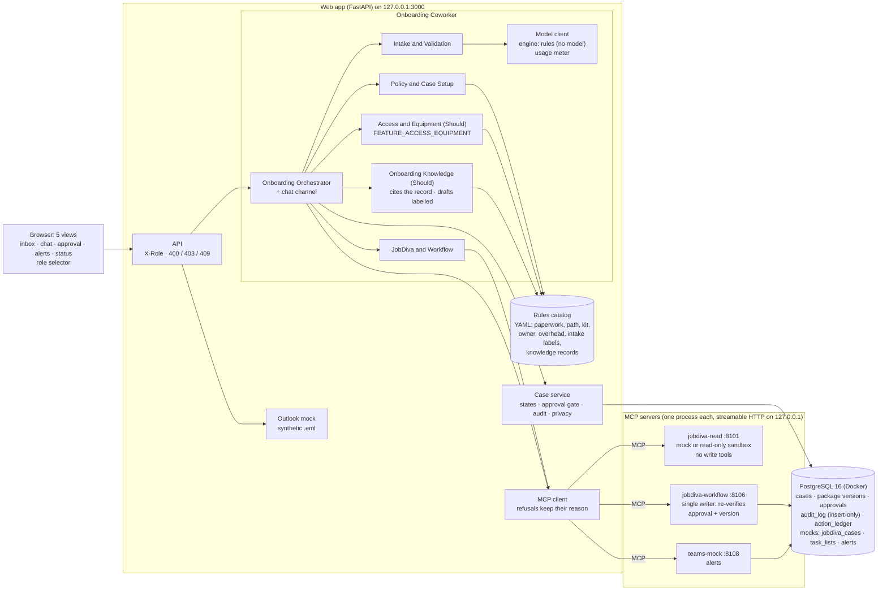

# Architecture as implemented

The design is SAD v1.2, Alternative B. This page shows what runs in the demo on October 28, 2026, and where it still differs from the target.

`AGENT_TRANSPORT=mcp` (the default in `.env.example`) runs the layout above: `start.sh` starts the three MCP servers before the web app, and the health check waits until each one answers. `AGENT_TRANSPORT=in_process` is the fallback for the demo: the agents call the same services the servers wrap, behind the same interfaces, with the same governance code. The Outlook mock is read by the web app's inbox in both modes.

## Where it matches the design

| Control | How it is enforced | Test |
|---|---|---|
| Approval gate (BR-002) | Every action re-verifies the approval ID against the current package version, inside the action's transaction | `test_no_action_without_approval`, `test_version_mismatch_blocked` |
| Single writer | Only `jobdiva_workflow` registers a write tool; the test scans every MCP server | `test_only_workflow_agent_writes` |
| Never write to JobDiva (BR-014) | The JobDiva READ server has no write tools; the sandbox client refuses anything but GET | `test_jobdiva_read` |
| Append-only audit | No database role has UPDATE, DELETE or TRUNCATE on `audit_log`; decisions and applied actions are insert-only | `test_every_action_is_audited` |
| Restricted data (BR-011) | The case service hides visa, sponsorship and FLSA from recruiter and IT; alerts name fields, never values | `test_it_role_does_not_see_restricted_fields`, `test_escalation` |
| No legal decisions (BR-001) | FLSA and classification conflicts become exceptions, escalated to the Onboarding Team and HR, and the package is blocked | `test_escalation` |
| Rules are data | Paperwork, path, kit, owner, overhead and intake labels are YAML with rule ID, owner and version | `test_rule_lookup` |

## Where it differs, and why

| Topic | Target (SAD) | Demo | Reason |
|---|---|---|---|
| Model | A model reads free text | `claude` engine (Claude Haiku 5.5) reads free text when `MODEL_PROVIDER=claude`; `rules` stays the default and the fallback | Restricted fields never reach the model; every call is metered and capped (ADR-006, TC-004) |
| Velocity 2.0 | Agent runtime | Delivery method | Corrected in ADR-006 |
