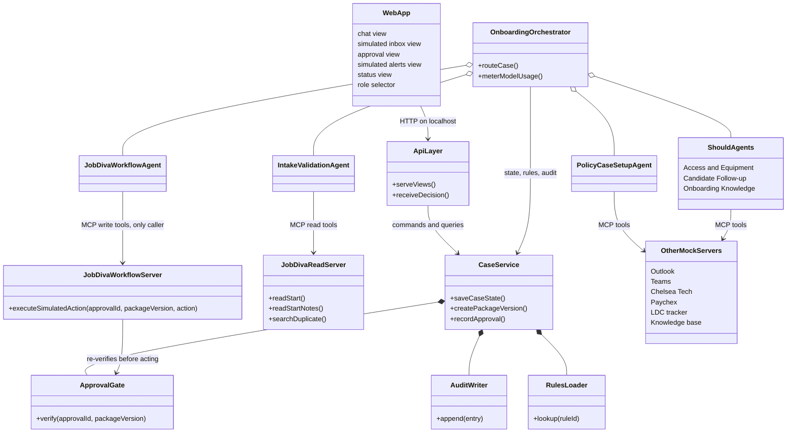
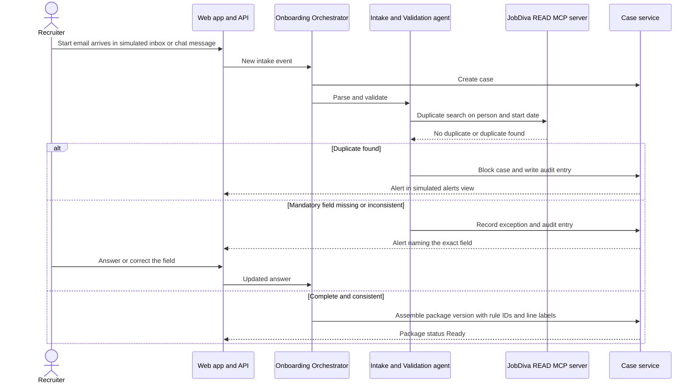
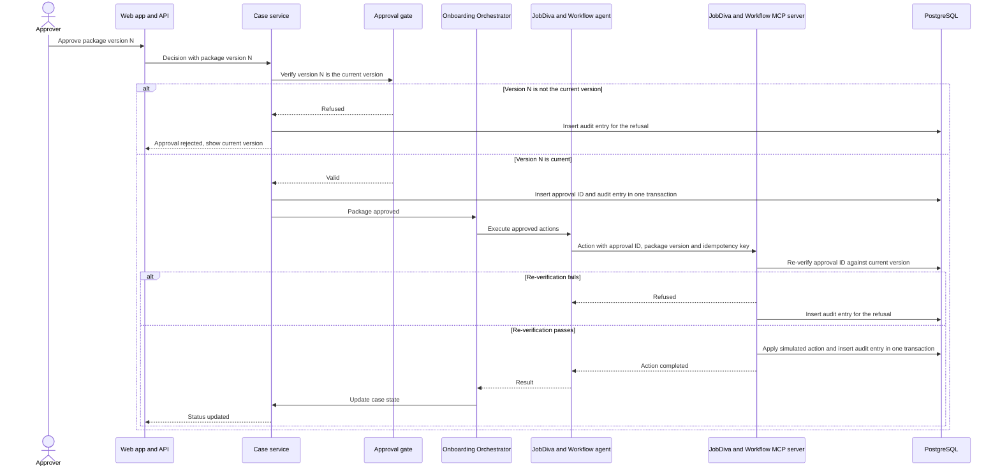
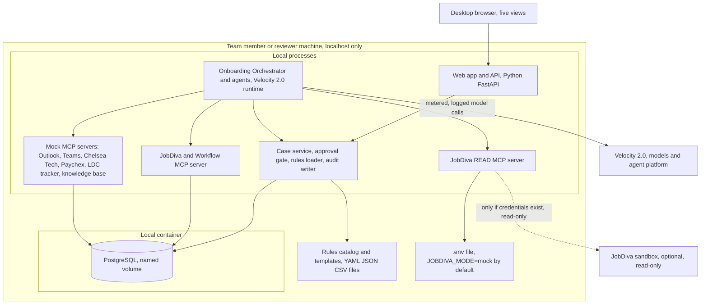
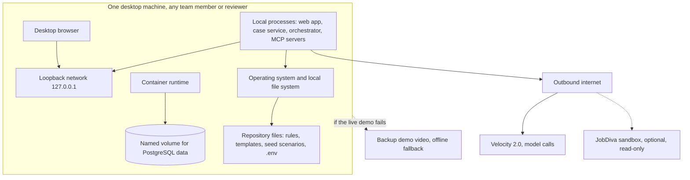

# Software Architecture Document
## Onboarding Digital Coworker

**Author**: Juan Carlos Giron, Solution Architect (AI Assisted)
**Date**: 2026-10-21
**Version**: 1.1
**Status**: Draft

> This document was generated automatically from the Architecture Alternatives & Evaluation document (`4-Architecture-alternatives-and-evaluation.md`, v1.0). It contains four sections: Recommended Architecture and Technical Constraints, Architecture Diagrams, Component Architecture, and Architecture Decision Records. No fields require manual completion. Review it and reply **"Signature approved"** when ready.

---

## Glossary

> This table explains the IDs and terms used in this document. It covers only terms that appear here.

| Term | Meaning |
|------|---------|
| ADR-XXX | Architecture Decision Record. A documented decision with its context, options considered and consequences (Section 4). ADR-001 is always the architecture selection itself |
| 4+1 | The default diagram approach. Four views (Logical, Process, Deployment, Physical) of the same architecture, each answering a different question about it (Section 2) |
| SKU | Stock Keeping Unit. A cloud provider's specific pricing or tier identifier for a resource (Section 3.3) |
| TC-XXX | Technology Constraint. Binding and never violated. Reproduced verbatim in Section 1.2 from the Architecture Alternatives & Evaluation document, Section 0.1 |
| STACK-XXX | Technology Stack item. The established default the alternatives build on, from the Architecture Alternatives & Evaluation document, Section 0.2 |
| NFR-XXX | Non-Functional Requirement scenario, defined in the NFR Register (`2-Nonfunctional-requirements.md`). Cited here where it shapes a decision |
| BR-XXX | Business Rule, defined in the Functional Requirements Specification. BR-002 is "actions only with an approval for the current package version". BR-014 is "the Coworker never writes to JobDiva" |
| MCP | Model Context Protocol. The tool-server interface through which agents call enterprise systems and mocks |
| J1 / J2 | The two Must user journeys. J1 is intake and validation. J2 is package, approval and simulated actions |
| Final Score | An alternative's overall weighted score across all quality attributes, computed in the Architecture Alternatives & Evaluation document |

---

## 1. Recommended Architecture and Technical Constraints

### 1.1 Recommended Architecture

**Selected: Alternative B, a Hub-and-Spoke Orchestrator with one MCP server per enterprise system (PostgreSQL).**

The Onboarding Orchestrator and its specialized agents run on Velocity 2.0. They call a local case service, which owns the case store, the approval gate and the audit log in PostgreSQL. Each enterprise system is its own MCP server process: JobDiva (read-only), JobDiva and Workflow (the only server holding write tools), Outlook mailbox, Teams, Chelsea Tech, Paychex, LDC tracker and the onboarding knowledge base. The whole system runs on localhost with synthetic data.

**Why Alternative B was selected.** B has the highest Final Score, **4.218**, against 4.052 for A and 3.338 for C. Security is the heaviest attribute at 24%, and B scores 4.79 there against 3.19 for A. The largest single scenario is NFR-SEC-003, the approval gate and action authorization (41% of Security). In B, write tools exist only in the JobDiva and Workflow server, which re-verifies the approval ID and package version itself. B is the only alternative that enforces BR-002 and BR-014 by process boundary and not by code convention. The same shape gives an INSERT-only audit role (NFR-SEC-004), a JobDiva token confined to one server (NFR-SEC-005), and one MCP interface across mock, sandbox and real systems (NFR-COMPAT-002, NFR-MAINT-001, NFR-MAINT-002). The main cost is Availability, which scores 3.12 ("Partial"), because a demo session depends on about nine processes and a container. The lead over A is modest (0.166), so the mitigations in the source's Risks & Mitigations are part of this recommendation.

**Why the runners-up were not selected:**
- **Alternative A, Modular Monolith with in-process adapters (4.052).** It is stronger on Availability (5.00), Reliability (4.50), Usability (4.34) and setup simplicity. However, the approval and JobDiva-read-only boundaries are enforced only by code discipline (NFR-SEC-003 and NFR-SEC-007 both score 3). It remains the designated fallback if the day-one spike shows that MCP servers and a container database cannot be delivered before October 28. The connector interface is the same, so in-process adapters can later become MCP servers.
- **Alternative C, Event-Driven Agent Pipeline (3.338).** Eventual consistency scores 2 on NFR-REL-006, the largest Reliability scenario, because approval, version and duplicate checks must be consistent immediately. It also has the lowest availability (2.12) and adds NATS JetStream, a broker that no STACK item establishes.

**Strategic Path Forward:**

| Phase | Window | Focus |
|-------|--------|-------|
| 1. Spike and core | October 21–23 | Confirm Velocity 2.0 can call local MCP servers. Confirm language and framework with the team. Stand up the case service, the PostgreSQL schema with the INSERT-only audit role, the approval gate and the JobDiva and Workflow server in mock mode. If the spike fails, fall back to Alternative A behind the same connector interface |
| 2. Journeys and connectors | October 23–26 | Build J1 and J2, the remaining mock servers and the five views. Add the negative governance tests: no action without approval, version mismatch blocked, no JobDiva write, no token in any log |
| 3. Hardening and presentation | October 26–28 | Single-command start, health checks and reset command. Run the seed scenarios end to end and record the backup demo video. After the demo, document the pilot path for the business owner, including whether the pilot needs any JobDiva write (which would require changing BR-014) |

### 1.2 Technical Constraints

**Formally declared Technology Constraints** (reproduced verbatim from Section 0.1 of the Architecture Alternatives & Evaluation document):

| Constraint | Where this document honors it |
|------------|-------------------------------|
| TC-001: Velocity 2.0 is mandatory for agent runtime, orchestration and models. | Section 2 (Logical and Deployment views place the orchestrator and agents on Velocity 2.0). Section 3.2 (Onboarding Orchestrator and agents). ADR-001 |
| TC-002: The application runs on localhost only. | Section 2 (Deployment and Physical views, loopback-only). Section 3.3 (no hosted environment). ADR-002 |
| TC-003: Synthetic data only, with no real JobDiva writes. | Section 2 (Process view: no write path to JobDiva). Section 3.2 (JobDiva READ and JobDiva and Workflow servers). ADR-004 |
| TC-004: Model usage must stay within the assigned budget. | Section 3.2 (orchestrator meters and logs model usage per run). Section 3.3 (model usage line). ADR-001 consequences |
| TC-005: No Microsoft Teams bot is required, because nobody on the team can register one in the INSPYR tenant. | Section 3.2 (Teams is a mock MCP server, not a bot). Section 2 (Teams appears only as a mock) |

**Additional constraints implied by the recommended alternative.** These are not formally declared Technology Constraints. They are practical boundaries implied by Alternative B's Concept, Weaknesses, Deployment Model, Cost Estimate and Risks.

| Constraint | Implied by (Alternatives & Evaluation section) | Where this document honors it |
|------------|-----------------------------------------------|-------------------------------|
| Write tools may be registered only in the JobDiva and Workflow server, which must re-verify the approval ID and package version itself | Alternative B, Concept (B.1) and Strengths (B.5) | Section 2 (Process view), Section 3.2, ADR-003 |
| The audit table must be writable by INSERT only | Alternative B, Concept (B.1) and Strengths (B.5) | Section 3.2 (Case service), ADR-002 |
| The JobDiva token must be held in memory only and confined to the JobDiva READ server | Alternative B, Component Breakdown (B.3) and Strengths (B.5) | Section 3.2 (JobDiva READ MCP server) |
| The JobDiva mode is fixed at startup by `JOBDIVA_MODE` (default `mock`) and never switches at runtime | Alternative B, Deployment Model (B.4) | Section 2 (Deployment View), ADR-004 |
| Mock stores must live in the same PostgreSQL instance as the audit table, so a simulated action and its audit entry commit together | Alternative B, Deployment Model (B.4) and Risks (Section 7) | Section 3.2 (Other mock MCP servers), ADR-002 |
| Every action must carry an idempotency key built from approval ID and action, so retries never duplicate completed actions | Alternative B, Risks & Mitigations (Section 7) and Strengths (B.5) | Section 2 (Process view), Section 3.2 |
| Every process must log with a shared case ID (correlation ID) | Alternative B, Weaknesses (B.6) | Section 3.2 |
| A container runtime is required on every machine that runs the demo | Alternative B, Weaknesses (B.6) and Cost Estimate (B.7) | Section 2 (Physical View), Section 3.3 |
| All inter-process links must bind to loopback only | Alternative B, Concept (B.1) and NFR-SEC-006 scoring | Section 2 (Physical View) |
| The Coworker never writes to JobDiva in any mode, including the sandbox. The architect resolved the JobDiva connection mode as Option 1 (read-only, BR-014 unchanged) | Alternatives & Evaluation, Section 0.3 point 2; NFR Register v1.1, NFR-SEC-007 | ADR-004 |

---

## 2. Architecture Diagrams

This document uses the **4+1 views**, the default. Switching to C4 would be an explicit change request and would regenerate this section.

### 2.1 Logical View

This view shows the functional structure of Alternative B and who may call whom. The Onboarding Orchestrator routes work to the specialized agents. The agents reach enterprise systems only through MCP servers. Only the JobDiva and Workflow agent calls the one server that has write tools, and that server checks the approval gate again on its own. The case service owns durable state, the approval gate, the rules loader and the audit writer.

| Element | Description |
|---------|-------------|
| WebApp, ApiLayer | Five views and a simulated role selector, served on localhost (STACK-003) |
| CaseService | Case state, package versions, approvals, rules loading and the audit writer. Backed by PostgreSQL |
| ApprovalGate | Confirms that an approval ID matches the current package version. Used by the case service and again by the JobDiva and Workflow server |
| AuditWriter | Appends every agent action, completed or refused. Append-only |
| RulesLoader | Reads paperwork, kit, owner and notification rules as data from open-format files (STACK-005) |
| OnboardingOrchestrator | Owns each case, routes work to agents on one shared context, meters and logs model usage per run (TC-004) |
| IntakeValidationAgent, PolicyCaseSetupAgent, JobDivaWorkflowAgent | The Must agents (STACK-002) |
| ShouldAgents | Access and Equipment, Candidate Follow-up and Onboarding Knowledge. Their failure turns package lines into exceptions and does not stop J1 or J2 |
| JobDivaReadServer | Read-only access to start, start notes and duplicate search, from the mock or the sandbox when credentials exist |
| JobDivaWorkflowServer | The only server with write tools, which are simulated actions on mock stores |
| OtherMockServers | Mock MCP servers behind one interface (STACK-004) |

### 2.2 Process View

These sequences show runtime behavior for the two Must journeys. The first covers intake and validation (J1). The second covers approval and simulated actions (J2), including the refusal path when an approval does not match the current package version.

**J1: intake and validation**

**J2: approval and simulated actions**

| Element | Description |
|---------|-------------|
| Approval gate check | Runs before any action and again inside the JobDiva and Workflow server. Both checks use the same database truth |
| Idempotency key | Built from approval ID and action. Retrying pending actions after a failure never duplicates completed ones (NFR-REL-005) |
| Single transaction for action and audit | Possible because the mock stores share the PostgreSQL instance (NFR-REL-002) |
| Alert naming the exact field | The recruiter always knows what to fix (usability, NFR-USE-001) |
| Failed dependency | The step fails visibly. The case keeps its state, the package status becomes blocked, an alert is shown and the failure is logged |

### 2.3 Deployment View

This view shows the software deployed onto its runtime. Everything runs on one machine and binds to loopback. Velocity 2.0 provides the agent runtime, orchestration and models (TC-001). The only external links are the model calls through Velocity 2.0 and an optional read-only JobDiva sandbox connection, used only when credentials exist.

| Element | Description |
|---------|-------------|
| Web app and API | Serves the five views and receives decisions. Python and FastAPI are an assumed default (STACK-006, ADR-005) |
| Case service | The only component that writes case state and approvals. Owns the approval gate and audit writer |
| Orchestrator and agents | Run on Velocity 2.0. The Must agents are Intake and Validation, Policy and Case Setup, and JobDiva and Workflow |
| MCP servers | Roughly nine processes in total including the web app and case service. Each connector is separately replaceable |
| PostgreSQL | Runs in a local container with a named volume. Holds cases, package versions, approvals, the append-only audit table and the mock stores |
| `.env` | All environment settings. `JOBDIVA_MODE` is fixed at startup and never switches at runtime. Only `.env.example` is committed |
| JobDiva sandbox | The only optional external integration, read-only and used only when credentials exist |

### 2.4 Physical View

This view shows the physical and network layer. TC-002 limits the system to localhost, so there are no regions, CDN or load balancers. The physical footprint is one desktop machine, a container runtime, a loopback network and two outbound paths.

| Element | Description |
|---------|-------------|
| Desktop machine | Any team or reviewer machine that can run the repository. A container runtime is required |
| Loopback network | All inter-process links bind to 127.0.0.1 only, so no inter-process link crosses a network (NFR-SEC-006) |
| Named volume | Holds PostgreSQL data. A reset command recreates it and reloads the seed scenarios |
| Outbound paths | Only model calls through Velocity 2.0, plus the optional read-only JobDiva sandbox |
| Backup demo video | The documented fallback for a failure on presentation day |

---

## 3. Component Architecture

### 3.1 Component Overview

> Owner reflects what the source documents establish. The Architecture Alternatives & Evaluation document names no individual owner per component, so every component is owned by the project team except the rules catalog content.

| Component | Description | Technology | Owner |
|-----------|-------------|------------|-------|
| Web app (5 views) | Chat, simulated inbox, approval, alerts and status views with a simulated role selector | Lightweight browser front-end (STACK-003) | Project team |
| API / web layer | Serves views, receives decisions, calls the case service | Python, FastAPI (assumed default, STACK-006) | Project team |
| Case service | Case state, package versions, approval gate, audit writer, rules loader | Python, FastAPI, PostgreSQL | Project team |
| Onboarding Orchestrator and agents | Routing, intake, validation, package assembly | Velocity 2.0 runtime (STACK-001, STACK-002) | Project team |
| JobDiva READ MCP server | Reads start, start notes and duplicate search from the mock, or from the sandbox when credentials exist | Python MCP server, token in memory only | Project team |
| JobDiva and Workflow MCP server | The only server with write tools (simulated actions). Re-verifies approval ID and package version | Python MCP server | Project team |
| Other mock MCP servers | Outlook, Teams, Chelsea Tech, Paychex, LDC tracker, knowledge base | Python MCP servers behind one interface (STACK-004) | Project team |
| Rules catalog and templates | Paperwork, kit, owner and notification rules as data | YAML / JSON / CSV files (STACK-005) | Project team for the loading mechanism. Onboarding, IT and LDC for the content (Alternatives & Evaluation, Section 8, item 4) |
| Case store and audit log | Durable state. Audit table writable by INSERT only | PostgreSQL in a local container | Project team |

### 3.2 Component Details

#### Web app and API layer

**Purpose:** Present the five views and carry user decisions to the case service.

**Responsibilities:**
- Render the chat, simulated inbox, approval, simulated alerts and status views
- Provide the role selector that simulates Recruiter, Onboarding Team, Approver and IT roles
- Show restricted data (visa, sponsorship, FLSA) only to authorized roles, using the case service's policy decision
- Pass each approval, return or rejection to the case service as a single decision

**Interfaces:**

| Interface | Type | Description |
|-----------|------|-------------|
| Browser to API | HTTP on localhost | Views, chat messages and approval decisions |
| API to case service | Internal call | Commands and queries on cases, package versions and approvals |

**Dependencies:**
- Case service

**Technology Stack:** Language Python (assumed default) / Framework FastAPI (assumed default) with a lightweight browser front-end / Runtime a local process. The version is not fixed in the source documents.

#### Case service

**Purpose:** Be the single owner of durable case truth, the approval gate and the audit log.

**Responsibilities:**
- Persist cases, state transitions, package versions and approvals in PostgreSQL
- Create a new package version on any change, which invalidates the earlier approval
- Check that an approval matches the current package version before any action is released
- Load the rules catalog and answer rule lookups with the rule ID
- Write each state change or action together with its audit entry in one transaction
- Enforce role-based filtering of restricted data and keep restricted values out of logs, referring to them by field and not by value

**Interfaces:**

| Interface | Type | Description |
|-----------|------|-------------|
| From API and orchestrator | Internal call | State, package, approval and rule operations |
| To PostgreSQL | SQL | Application role for state. A separate INSERT-only role for the audit table |
| From JobDiva and Workflow server | Shared database read | Re-verification of approval ID against the current package version |

**Dependencies:**
- PostgreSQL
- Rules catalog files

**Technology Stack:** Language Python (assumed default) / Framework FastAPI (assumed default) / Runtime a local process with PostgreSQL in a local container.

#### Onboarding Orchestrator and agents

**Purpose:** Run each case end to end by routing work to specialized agents on one shared context.

**Responsibilities:**
- Own each case and route it to the right agent
- Run the Must agents: Intake and Validation, Policy and Case Setup, JobDiva and Workflow
- Run the Should agents (Access and Equipment, Candidate Follow-up, Onboarding Knowledge) so that their failure produces package exceptions without stopping J1 or J2
- Meter and log model usage per run and per case, apply a per-run cap and use smaller models for extraction (TC-004)
- Let only the JobDiva and Workflow agent call the server that holds write tools

**Interfaces:**

| Interface | Type | Description |
|-----------|------|-------------|
| To MCP servers | MCP tool calls | Read and simulated-write tools, one server per enterprise system |
| To case service | Internal call | Case state, rule lookups, package versions, audit entries |
| To Velocity 2.0 | Platform model calls | Metered and logged model usage |

**Dependencies:**
- Velocity 2.0 (agent runtime, orchestration, models)
- Case service
- MCP servers

**Technology Stack:** Language the Velocity 2.0 agent runtime (the specific models per agent are not yet decided, STACK-006) / Framework Velocity 2.0 / Runtime Velocity 2.0 runtime.

#### JobDiva READ MCP server

**Purpose:** Give agents read-only access to JobDiva data, from the mock by default.

**Responsibilities:**
- Read start, start notes and duplicate search from the mock, or from the sandbox only when credentials exist
- Hold the JobDiva token in memory only, loaded from `.env`, and never write it to any log
- Register no write tools, so the Coworker has no write path to JobDiva (BR-014, TC-003)
- Fix `JOBDIVA_MODE` at startup, defaulting to `mock`, and never switch at runtime

**Interfaces:**

| Interface | Type | Description |
|-----------|------|-------------|
| Read tools | MCP | Start, start notes and duplicate search |
| To JobDiva sandbox | HTTPS, optional | Read-only, only when credentials exist |

**Dependencies:**
- `.env` file
- Synthetic seed data for mock mode

**Technology Stack:** Language Python (assumed default) / Framework MCP server / Runtime a local process.

#### JobDiva and Workflow MCP server

**Purpose:** Be the single place where simulated actions are executed.

**Responsibilities:**
- Hold the only write tools in the system, acting on mock stores
- Re-verify the approval ID and package version itself before every action
- Apply each action and its audit entry in one transaction, using an idempotency key built from approval ID and action
- Record completed actions so that pending ones can be retried with the same approval ID without duplicates
- Act only on mock stores. It has no tool that reaches JobDiva, in mock or sandbox mode (ADR-004)

**Interfaces:**

| Interface | Type | Description |
|-----------|------|-------------|
| Write tools | MCP | Simulated actions, each requiring approval ID, package version and idempotency key |
| To PostgreSQL | SQL | Approval re-verification, action ledger and audit inserts |

**Dependencies:**
- PostgreSQL (shared with the case service)
- Approval gate logic

**Technology Stack:** Language Python (assumed default) / Framework MCP server / Runtime a local process.

#### Other mock MCP servers

**Purpose:** Simulate Outlook mailbox, Teams, Chelsea Tech, Paychex, the LDC tracker and the onboarding knowledge base behind one interface.

**Responsibilities:**
- Serve synthetic data only (TC-003)
- Keep one interface across mock, sandbox and real modes, so the pilot swap needs no agent change
- Keep simulated Teams messages inside the simulated alerts view, since no Teams bot exists (TC-005)
- Keep their mock stores in the same PostgreSQL instance as the audit table

**Interfaces:**

| Interface | Type | Description |
|-----------|------|-------------|
| Tools per system | MCP | Read and simulated-action tools per enterprise system |
| To PostgreSQL | SQL | Mock stores |

**Dependencies:**
- PostgreSQL
- Seed scenarios

**Technology Stack:** Language Python (assumed default) / Framework MCP servers / Runtime local processes.

#### Rules catalog and templates

**Purpose:** Hold business rules and notification templates as data, so changing a rule never requires changing an agent.

**Responsibilities:**
- Store paperwork, kit, owner and notification rules in open formats (STACK-005)
- Carry a rule ID that is cited in every recommendation and package line
- Be loaded by the case service at startup and on update

**Interfaces:**

| Interface | Type | Description |
|-----------|------|-------------|
| Rule lookup | File read by the case service | Rule by ID or by case attributes |

**Dependencies:**
- None at runtime beyond the case service that loads it

**Technology Stack:** Format YAML, JSON and CSV files / No framework / Read by the Python case service.

### 3.3 Deployment Components: SKU and Pricing (Production vs. Non-Production)

**No cloud provider applies to this architecture, so no live pricing lookup was performed.** The recommended architecture's Deployment Model is localhost only (TC-002). All components run as local processes or in a local container on team and reviewer machines. There is no Azure, AWS or GCP resource and therefore no SKU, tier or provider price to look up. No price has been stated from memory.

Two further points apply:

- **Environments.** The Deployment Model defines **one environment (localhost)**, so no separate Production and Non-Production environments exist. Development and demo both use this environment. Both columns are shown below. The Production columns describe the single demo environment, and the Non-Production columns state that none exists.
- **Figures that come from the source.** The model usage range and the optional container-runtime fee come from the Cost Estimate of Alternative B in the Architecture Alternatives & Evaluation document. They are planning estimates, not looked-up prices, and no pricing page was consulted for them. Velocity 2.0 license cost is not stated in the source and is excluded.

| Component | Prod SKU / Tier | Prod Price (est.) | Non-Prod SKU / Tier | Non-Prod Price (est.) | Source (URL, checked 2026-10-21) |
|-----------|-----------------|-------------------|---------------------|-----------------------|----------------------------------|
| Web app and API | Local process, no cloud SKU | $0/month | None, no separate environment | $0/month | Alternatives & Evaluation B.7 (Compute). No provider URL, since there is no cloud provider |
| Case service | Local process, no cloud SKU | $0/month | None, no separate environment | $0/month | Alternatives & Evaluation B.7 (Compute). No provider URL |
| Orchestrator and agents (compute) | Local process on Velocity 2.0 runtime, no cloud SKU | $0/month | None, no separate environment | $0/month | Alternatives & Evaluation B.7 (Compute). No provider URL |
| MCP servers (JobDiva READ, JobDiva and Workflow, six mocks) | Local processes, no cloud SKU | $0/month | None, no separate environment | $0/month | Alternatives & Evaluation B.7 (Compute). No provider URL |
| PostgreSQL case store and audit log | Local container with named volume, no cloud SKU | $0/month (storage well under 1 GB) | None, no separate environment | $0/month | Alternatives & Evaluation B.7 (Storage). No provider URL |
| Model usage through Velocity 2.0 | Metered usage, no SKU (Velocity 2.0 license excluded) | $40–$120/month | None, no separate environment. The range covers all use of the single environment | $0/month separate | Alternatives & Evaluation B.7 (Licensing / Services). Not looked up on a pricing page |
| Container runtime (optional paid tier) | Free runtime, or a paid per-seat tier if needed | $0 with a free runtime, or up to $144/month (six seats at up to $24) | None, no separate environment | $0/month separate | Alternatives & Evaluation B.7. Not re-verified on a pricing page in this run |
| **Total (est.)** | | **$40–$264/month** | | **$0/month** | Assumed planning range. No numeric budget is stated in the source |

**Re-pricing trigger.** If a hosted environment replaces localhost (Alternatives & Evaluation, Section 8, item 6), production and non-production infrastructure budgets should be set separately. This table should then be regenerated with SKUs and prices looked up live from the chosen provider's official pricing calculator, each with its URL and check date.

---

## 4. Architecture Decision Records

### 4.1 ADR Index

| ADR | Title | Status | Date | Deciders |
|-----|-------|--------|------|----------|
| ADR-001 | Select Hub-and-Spoke Orchestrator with one MCP server per enterprise system | Accepted (pending Phase 2 sign-off) | 2026-10-21 | Juan Carlos Giron, Solution Architect |
| ADR-002 | Use PostgreSQL in a local container as the case store and audit log | Accepted (pending Phase 2 sign-off) | 2026-10-21 | Juan Carlos Giron, Solution Architect |
| ADR-003 | Register write tools only in the JobDiva and Workflow MCP server | Accepted (pending Phase 2 sign-off) | 2026-10-21 | Juan Carlos Giron, Solution Architect |
| ADR-004 | Keep JobDiva access read-only: no writes to JobDiva in any mode | Accepted (pending Phase 2 sign-off) | 2026-10-21 | Juan Carlos Giron, Solution Architect |
| ADR-005 | Use Python and FastAPI as the assumed default implementation stack | Accepted, provisional, to be confirmed by the day-one spike | 2026-10-21 | Juan Carlos Giron, Solution Architect |

### 4.2 Individual ADRs

#### ADR-001: Select Hub-and-Spoke Orchestrator with one MCP server per enterprise system

**Date / Status / Deciders:** 2026-10-21 / Accepted (pending Phase 2 sign-off) / Juan Carlos Giron, Solution Architect

**Context.** An architecture must be chosen for the Onboarding Digital Coworker. It must run on localhost with synthetic data and Velocity 2.0 (TC-001 to TC-005, Section 1.2). It must enforce the approval gate and the "Coworker never writes to JobDiva" rule (BR-002, BR-014), and it must be demonstrable by October 28, 2026.

**Decision Drivers.**
- Security is the heaviest quality attribute (24%). The approval gate and action authorization (NFR-SEC-003) are 41% of it
- Immediate consistency of approval, version and duplicate checks (NFR-REL-006)
- Independent replaceability of agents and connectors (STACK-004, NFR-COMPAT-002)
- Demo-day availability (NFR-AVAIL-001) and reproducibility (NFR-COMPAT-003)

**Considered Options.**
- **Alternative A, Modular Monolith with in-process tool adapters (SQLite).** One local service hosts everything. Final Score 4.052
- **Alternative B, Hub-and-Spoke Orchestrator with one MCP server per enterprise system (PostgreSQL).** Orchestrator on Velocity 2.0 and a case service in front of PostgreSQL, with each enterprise system as its own MCP server. Final Score 4.218
- **Alternative C, Event-Driven Agent Pipeline over a durable event log (PostgreSQL and NATS JetStream).** Agents and connectors are asynchronous consumers. Final Score 3.338

**Decision Outcome.** Alternative B is chosen. It is the only option that enforces the write boundary and secret confinement by process boundary, and it scores 4.79 on Security against 3.19 for A.

**Consequences.**
- *Positive:* process-level enforcement of NFR-SEC-003 and NFR-SEC-007. An INSERT-only audit role (NFR-SEC-004). The token is confined to one server (NFR-SEC-005). Each connector is replaceable without touching agents (NFR-COMPAT-002, NFR-MAINT-001). A failing Should connector is isolated (NFR-REL-004)
- *Negative:* about nine processes plus a container lower demo-day availability (NFR-AVAIL-001, score 3.12) and portability (NFR-COMPAT-003). Logs from several processes need a shared case ID to stay analysable (NFR-MAINT-003)
- *Risks:* demo-day failure from the number of processes. Action and audit atomicity across the process boundary (NFR-REL-002). Model usage above budget (TC-004). Unconfirmed team MCP and container skills. Velocity 2.0 not invoking local MCP servers as assumed. Mitigations: one start script with health checks and a tested reset, shared database commits and idempotency keys, per-run model caps, a day-one spike, and a fallback to Alternative A behind the same connector interface

#### ADR-002: Use PostgreSQL in a local container as the case store and audit log

**Date / Status / Deciders:** 2026-10-21 / Accepted (pending Phase 2 sign-off) / Juan Carlos Giron, Solution Architect

**Context.** The database engine is not decided by the stack (STACK-006). Cases, package versions, approvals and the audit log must survive a restart, the audit log must be append-only, and the system must run only on localhost (TC-002).

**Decision Drivers.**
- Durable storage of approvals and audit across restarts (NFR-REL-001)
- Database-enforced append-only audit (NFR-SEC-004)
- Atomic commit of a simulated action and its audit entry (NFR-REL-002)
- Low setup cost on any team or reviewer machine

**Considered Options.**
- **Embedded SQLite, as in Alternative A.** Simplest setup. No database roles, so audit immutability rests on triggers and application behavior
- **PostgreSQL in a local container.** Supports an INSERT-only role and lets mock stores share one instance with the audit table
- **PostgreSQL plus NATS JetStream, as in Alternative C.** Adds a second store and a broker that no STACK item establishes

**Decision Outcome.** PostgreSQL in a local container with a named volume. The audit table is writable by INSERT only. The mock stores live in the same instance, so an action and its audit entry commit together.

**Consequences.**
- *Positive:* enforceable audit immutability. Durable state across restarts (NFR-REL-001 scores 5). A single source of truth for approval re-verification
- *Negative:* a container runtime is required on every machine, which lowers portability (NFR-COMPAT-003). The runtime may need a paid per-seat tier, up to $144/month across six seats (Section 3.3)
- *Risks:* a lost or corrupted volume loses cases and approvals. Mitigation: the reset command reloads seed scenarios, and all data except cases, approvals and audit is synthetic and regenerable

#### ADR-003: Register write tools only in the JobDiva and Workflow MCP server

**Date / Status / Deciders:** 2026-10-21 / Accepted (pending Phase 2 sign-off) / Juan Carlos Giron, Solution Architect

**Context.** Actions on systems may happen only with an approval ID for the current package version, and only through the JobDiva and Workflow agent (BR-002). The Coworker never writes to JobDiva (BR-014). The question is whether this is enforced by code convention or by tool registration and process isolation. See also the constraints in Section 1.2.

**Decision Drivers.**
- NFR-SEC-003 and NFR-SEC-007 are the two largest-weighted security scenarios
- A single defect must not be able to bypass the approval gate
- Each connector must be independently replaceable (STACK-004)

**Considered Options.**
- **In-process adapters with the check as a function call, as in Alternative A.** Both scenarios score 3
- **One MCP server per system with write tools registered only in the JobDiva and Workflow server, which re-verifies the approval itself, as in Alternative B.** Both scenarios score 5
- **Event consumers with one executing worker, as in Alternative C.** Replayed or reordered events complicate the check (NFR-SEC-003 scores 4)

**Decision Outcome.** Write tools exist only in the JobDiva and Workflow MCP server. The JobDiva READ server registers no write tools and alone holds the token. The JobDiva and Workflow server re-verifies the approval ID and package version against the shared database before every action.

**Consequences.**
- *Positive:* the write boundary is enforced by process and tool registration. The simulation boundary is physical (NFR-COMP-001). The token never reaches other processes (NFR-SEC-005)
- *Negative:* two JobDiva-related servers to maintain. The version must be re-verified across a process boundary, which scores one point below Alternative A on NFR-REL-006
- *Risks:* an action completing without its audit entry. Mitigation: shared-database commit, intent-then-outcome records and idempotency keys on approval ID and action

#### ADR-004: Keep JobDiva access read-only: no writes to JobDiva in any mode

**Date / Status / Deciders:** 2026-10-21 / Accepted (pending Phase 2 sign-off) / Juan Carlos Giron, Solution Architect

**Context.** The Answers record held two statements about JobDiva. One says read-only sandbox and no writes (BR-014, TC-003). The other asked that the connector may also create synthetic test records in a separate sandbox-write mode, which would change BR-014 to "never writes to production JobDiva" and need committee approval and an API user with sandbox write permission. The architect resolved this as Option 1 (read-only).

**Decision Drivers.**
- TC-003 and BR-014 are binding, and the approved October 14 checkpoint states that the Coworker never writes to JobDiva, not even in the sandbox
- NFR-SEC-007 (v1.1): no write to JobDiva in any mode
- Real and synthetic data must never be mixed
- A committee approval for sandbox writes might not arrive before October 28, 2026

**Considered Options.**
- **Option 1: mock by default with an optional read-only sandbox, and no JobDiva writes.** Follows TC-003 and BR-014 with no approval needed
- **Option 2: a sandbox-write mode that creates synthetic test records in the sandbox.** Needs a BR-014 change, committee approval and an API user with write permission

**Decision Outcome.** Option 1. `JOBDIVA_MODE` is fixed at startup and accepts `mock` (default) or `sandbox`. In sandbox mode the JobDiva READ server only reads a test candidate's start, its start notes and the duplicate search. No server has a tool that writes to JobDiva, and a write requested in sandbox mode is refused and logged. To test a real connection, team members create test candidates manually in the JobDiva sandbox web interface.

**Consequences.**
- *Positive:* full compliance with TC-003, BR-014 and the checkpoint, with no dependency on a committee decision. The architecture could host a write mode in a later pilot with no structural change
- *Negative:* test candidates in the sandbox must be created by hand
- *Risks:* none specific to the hackathon. If the pilot needs JobDiva writes, BR-014 must change and this ADR is superseded (Alternatives & Evaluation, Future Considerations)

#### ADR-005: Use Python and FastAPI as the assumed default implementation stack

**Date / Status / Deciders:** 2026-10-21 / Accepted, provisional, to be confirmed by the day-one spike / Juan Carlos Giron, Solution Architect

**Context.** STACK-006 leaves the programming language, the web app framework, the database engine and the models per agent undecided, to be chosen from what Velocity 2.0 supports and what the team can deliver by October 28, 2026. The source documents do not confirm the team's languages or its Velocity 2.0 and MCP experience.

**Decision Drivers.**
- The web app, case service and MCP servers should share one language to cut the learning surface
- Compatibility with Velocity 2.0 and with MCP server development
- Delivery by October 28, 2026, with a single-command start

**Considered Options.**
- **Python with FastAPI.** The assumed default in all three alternatives, so they differ in pattern and not in language
- **A different language or web framework.** Possible if the spike or the team's skills point elsewhere, but not evidenced in the source documents

**Decision Outcome.** Python with FastAPI for the web/API layer, the case service and the MCP servers, with a lightweight browser front-end. This is an assumed default and stays flagged as such until confirmed against Velocity 2.0 SDK support and the team's skills on day one.

**Consequences.**
- *Positive:* one language across services. Fits the shared MCP server template that the mitigation for team-skill risk relies on
- *Negative:* if Velocity 2.0 or the team favors another language, the services must be re-targeted. The specific models per agent also remain undecided
- *Risks:* the team lacks the assumed skills. Mitigation: confirm skills on day one, share one MCP server template across all connectors, and fall back to Alternative A's in-process adapters behind the same interface

---
## Document Control

| Field | Value |
|-------|-------|
| Author | Juan Carlos Giron, Solution Architect (AI Assisted) |
| Approval Authority | Juan Carlos Giron, Solution Architect |
| Status | Draft |
| Signature | ⏳ Pending — awaiting approval |

### Change Log

| Version | Date | Changes |
|---------|------|---------|
| 1.0 | 2026-10-21 | Generated from Architecture Alternatives & Evaluation v1.0 |
| 1.1 | 2026-10-21 | Applied the architect's JobDiva decision (Option 1, read-only): rewrote ADR-004 as a closed decision, and removed the sandbox-write mode from the Strategic Path Forward, the implied constraints (Section 1.2) and the JobDiva and Workflow server responsibilities. Named Juan Carlos Giron as author, approver and decider of every ADR. Removed a duplicate end-of-document marker. Architecture, diagrams and scores are unchanged. |

*— End of document —*
