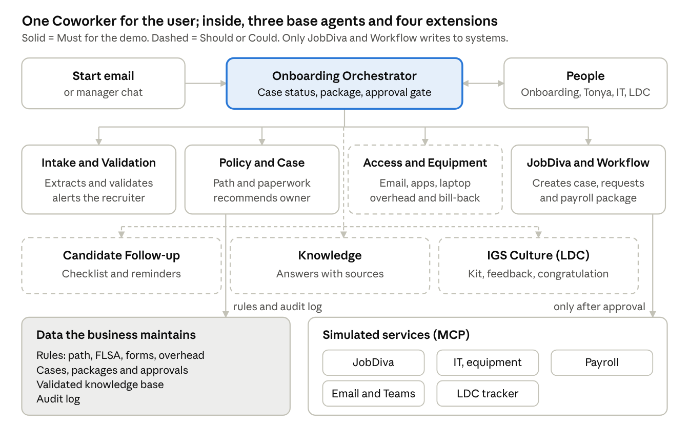

# Onboarding Digital Coworker

A multi-agent Digital Coworker for INSPYR that turns a new-hire notification into a complete, validated and approved onboarding case. **It chases the information, reminds and prepares; people decide and approve.**

Built for the INSPYR *Movers n’ Shakers* hackathon (October 2026) on **Velocity 2.0**. Business owner: **Tonya Ramirez**, Consultant Onboarding Supervisor.

> **Status:** the Must journeys J1 (intake and validation) and J2 (package, approval and simulated actions) run end to end in a local demo, with synthetic data only. Every hackathon deliverable is listed in [Documents/Submission](Documents/Submission/README.md).

| Milestone | Date | Status |
| --- | --- | --- |
| Checkpoint: design and scope | October 14, 2026 | Delivered: [checkpoint deliverable](Documents/CheckPoint/14October/checkpoint-deliverable.md) |
| Velocity stages: understanding, architecture, development | October 15–26 | Done: [Documents/Velocity](Documents/Velocity/) |
| Governance core, agents, web app (J1 and J2) | October 26 | Done: automated tests and evidence in [code/tests/evidence](code/tests/evidence/) |
| Presentation and backup video | By October 28 | In progress |
| Final submission | October 28, 2026 | Planned |

## Business problem and expected outcome

When a recruiter submits a start in JobDiva, the most useful fields (work location, FLSA, billing contact, timesheet approver, equipment, sponsorship and visa) are optional. They often arrive blank, so the onboarding team chases data by email, picks paperwork from memory and reconciles payroll reports by hand.

The Coworker moves validation to the start: nothing reaches onboarding incomplete, and nothing reaches a system without human approval.

| Metric | Baseline | Target |
| --- | --- | --- |
| Document onboarding (receipt to documents complete) | ~3 days | 1 to 1.5 days (pilot) |
| Cases reaching onboarding with missing data and no alert | Frequent | 0 |
| Time from the last answer to a package ready for approval | Not applicable | 5 minutes or less |
| Actions executed without human approval | Not applicable | 0 |

## Digital Coworker responsibilities

| The Coworker | People |
| --- | --- |
| Reads the start email or chat and detects missing or inconsistent data | The recruiter corrects the flagged fields |
| Recommends path, paperwork, owner, access and equipment, citing the rule | The Onboarding Team confirms the case and resolves escalations |
| Builds an approval package with the source of every data point | Tonya Ramirez approves, returns or rejects the package |
| Creates the JobDiva case and requests (simulated) only after approval, and keeps JobDiva updated | IT approves laptops; LDC approves the welcome kit and feedback |
| Logs every action for audit | The business maintains the rules and validates new knowledge |

The Coworker never decides worker classification, compensation or legal employment questions; unclear cases are escalated to the Onboarding Team.

**MVP scope (Must):** intake by email or chat, adaptive questions, validation of the 7 recruiter-note fields, rule-based path and paperwork, onboarding owner, approval package, approval gate, simulated actions with JobDiva kept current, duplicate prevention and audit log. Should and Could items are listed in the [checkpoint deliverable](Documents/CheckPoint/14October/checkpoint-deliverable.md#2-prioritized-capabilities-and-responsibilities).

## Agent architecture and orchestration

To users it is one Coworker. Inside, an Onboarding Orchestrator owns the case and splits the work across specialized agents that share one context. Only the JobDiva and Workflow agent writes to systems, and only with an approval ID for the current package version.



The architecture as it runs in the demo, with its controls and the tests behind them, is in [Documents/Submission/architecture.md](Documents/Submission/architecture.md). The demo implements the four Must agents, the Access and Equipment agent (Should, behind `FEATURE_ACCESS_EQUIPMENT`), the shared notifications tool and the mocks for JobDiva, Outlook and Teams. The other Should and Could agents are not built yet.

| Agent | Priority | Responsibility |
| --- | --- | --- |
| Onboarding Orchestrator | Must | Case state, routing, timing, escalations, approval package and approval gate |
| Intake and Validation | Must | Extracts fields from email or chat, checks completeness and consistency, detects duplicates |
| Policy and Case Setup | Must | Rule engine: path, FLSA agreement, state, city and client forms, onboarding owner |
| JobDiva and Workflow | Must | After approval, creates and updates the JobDiva case, requests, task list and payroll package |
| Access and Equipment | Should | Email, Teams, apps, laptop, 2% or 5% overhead and bill-back |
| Candidate Follow-up | Should | Checklist, tiered reminders and document verification |
| Onboarding Knowledge | Should | Answers process questions from validated records; proposes drafts for human validation |
| Culture and Belonging (IGS) | Could | LDC tracker, welcome kit and two-month feedback |

Case lifecycle and the demo sequence are documented in [section 5 of the checkpoint deliverable](Documents/CheckPoint/14October/checkpoint-deliverable.md#5-solution-design).

## Prerequisites and installation

- **Python 3.12 or later**
- **Docker** (Docker Desktop on Windows), for the local PostgreSQL 16
- **Git Bash or WSL** on Windows, to run the `scripts/*.sh`
- No model API key needed: the default model engine (`MODEL_PROVIDER=rules`) uses no model. With an Anthropic API key, `MODEL_PROVIDER=claude` reads start details written as free text (see ADR-006 in the [Software Architecture Document](Documents/Velocity/02.%20Architecture/))

```bash
git clone https://github.com/juangiron-IGS/OnBoardingDigitalCoworker.git
cd OnBoardingDigitalCoworker/code
python -m venv .venv
.venv/Scripts/python -m pip install -e ".[dev]"   # macOS/Linux: .venv/bin/python
cp .env.example .env
```

In `code/.env`:
- set `DB_ADMIN_PASSWORD`, `DB_APP_PASSWORD` and `DB_AUDIT_PASSWORD`;
- put the last two inside `DATABASE_URL` and `AUDIT_DATABASE_URL`;
- keep `JOBDIVA_MODE=mock`.

## Configuration

All configuration comes from environment variables in `code/.env`. The repository ships [`code/.env.example`](code/.env.example) with the names only, and `.env` is git-ignored. The settings that matter for the demo:

| Variable | Default | Purpose |
| --- | --- | --- |
| `DATABASE_URL` / `AUDIT_DATABASE_URL` | none | PostgreSQL as the application role, and as the INSERT-only audit role |
| `DB_PORT`, `DB_NAME`, `DB_*_PASSWORD` | `5432`, `coworker` | The local container and its roles |
| `WEB_APP_PORT` | `3000` | Web app on `127.0.0.1` |
| `MODEL_PROVIDER` | `rules` | Model engine. `rules` reads labelled messages with no model and no key; `claude` also reads free text |
| `ANTHROPIC_API_KEY`, `ANTHROPIC_WORKSPACE_ID`, `MODEL_EXTRACTION` | none, none, `claude-haiku-5-5` | `claude` engine only: the key (never committed), the workspace when the key is not scoped to one, and the model that reads start details |
| `MODEL_USAGE_CAP_PER_RUN` | `50` | Model calls allowed per run |
| `FEATURE_ACCESS_EQUIPMENT` | `false` (`.env.example`: `true`) | Access and Equipment agent: laptop and access request, 2% or 5% overhead, bill-back, IT approval |
| `AGENT_TRANSPORT` | `in_process` (`.env.example`: `mcp`) | `mcp`: agents call the JobDiva READ, JobDiva and Workflow, and Teams MCP servers over HTTP. `in_process`: fallback that calls the same services directly |
| `JOBDIVA_MODE` | `mock` | `mock`, or read-only `sandbox` for the JobDiva READ server |
| `JOBDIVA_BASE_URL`, `JOBDIVA_CLIENT_ID`, `JOBDIVA_API_USER`, `JOBDIVA_API_PASSWORD` | none | Sandbox mode only: Client ID from JobDiva support and a dedicated API user |

## How to run the solution

From `code/` (in Git Bash or WSL on Windows):

```bash
./scripts/start.sh     # PostgreSQL, database setup on first run, MCP servers, web app, health check
./scripts/stop.sh      # stop the web app and MCP servers (--all also stops PostgreSQL; data is kept)
./scripts/reset.sh     # recreate the database with the seed data
```

`start.sh` ends with one line such as `web app: ok · database: ok · transport: mcp · JobDiva: mock · model: rules · MCP: jobdiva-read ok, jobdiva-workflow ok, teams-mock ok`. Then open http://127.0.0.1:3000.

Quality gates, also run from `code/`:

```bash
.venv/Scripts/python -m pytest      # uses a separate <DB_NAME>_test database
.venv/Scripts/python -m ruff check . && .venv/Scripts/python -m ruff format --check .
```

## How to run the demonstration

Follow [Documents/Submission/demo-script.md](Documents/Submission/demo-script.md). It takes about 7 minutes and uses synthetic data only:

1. A start email arrives in the simulated mailbox (**New email**) with two fields missing. The recruiter gets an alert naming them, in the Teams-like chat panel.
2. The recruiter answers in the chat, one question at a time. The package is built with a rule ID on every recommendation.
3. Someone asks for the case status in the chat.
4. IT cannot see FLSA or sponsorship, and approves the laptop and access request (2% overhead, bill-back by rule). The approver can see them, assigns the follow-up owner and approves package v1.
5. The single writer creates the JobDiva case (mock), the task list and the Chelsea Tech request, each with the approval ID. The status view shows the full audit log and whether the package met the 5-minute target.
6. Guardrails:
   - a duplicate start is blocked;
   - an FLSA conflict between the email and JobDiva is escalated and blocks the package;
   - a person already onboarding in JobDiva is blocked.

## Security and governance considerations

- **Human in the loop:** every action on a system, access, equipment or purchase needs explicit approval of the current package version.
- **No legal decisions:** FLSA, classification and compensation come from the field or HR; conflicts are escalated.
- **Traceability:** every package line is labeled (source, inferred, recommended, exception) and every agent action is in the audit log.
- **Data:** synthetic data only; no connection to client production environments. Visa, sponsorship and FLSA are restricted by role.
- **Secrets:** no credentials in the repository; the JobDiva token lives in memory and is never logged.
- **JobDiva:** the Coworker never writes to JobDiva, not even in the sandbox.
- **Duplicates:** a request or case with the same person and start date is blocked.
- **Cost:** model usage stays within the assigned budget and is logged per run.

## Known limitations

- **Everything is simulated.** All enterprise systems (JobDiva, IT and equipment, payroll, email, Teams, LDC tracker) are mocks in the hackathon.
- **Free text needs the `claude` engine.** With `rules`, a new start must be sent as `Label: value` lines. With `claude`, labelled lines are still read first at no cost, and Claude reads only the fields still missing. FLSA, sponsorship and visa are never sent to the model: they come from labelled lines or from the recruiter's answers.
- **JobDiva sandbox.** Its endpoints follow integrator guides and must be confirmed against JobDiva's API documentation. It also needs API credentials. The web app always reads JobDiva in mock mode.
- **Draft rules.** Paperwork, path, kit and owner rules are example content marked `status: draft`, until the Onboarding Team confirms them.
- **Not built yet:** the Should and Could agents Candidate Follow-up, Onboarding Knowledge and Culture and Belonging.
- **Out of scope:** background checks, I-9, payroll processing and real e-signature.

## Reusable components

- **JobDiva connector** (`code/mcp_servers/jobdiva_read/`): mock and read-only sandbox modes behind one interface; the token stays in memory
- **Single-writer MCP server** (`code/mcp_servers/jobdiva_workflow/`): approval re-verified in the action's transaction, with idempotency keys
- **Rules catalog as data** (`code/rules/`, `RulesCatalog`): rule ID, owner, version and status, maintained by the business
- **Approval package and approval gate** (`code/services/case_service/`): labelled, sourced data points and versioned packages
- **Append-only audit log** (`code/db/`): agent, action, outcome, rules used and data used, enforced by database roles
- **Model client** (`code/agents/common/model_client.py`): one interface, replaceable engines and a usage meter

## Repository structure

```
.
├── code/                        Application (dependencies: code/THIRD_PARTY_LICENSES.md)
│   ├── agents/                  Orchestrator (+ chat), Intake and Validation, Policy and Case Setup, JobDiva and Workflow
│   ├── services/case_service/   Case states, approval gate, audit, privacy, rules catalog
│   ├── mcp_servers/             jobdiva_read, jobdiva_workflow (single writer), mocks (outlook, teams)
│   ├── contracts/               Interfaces shared by both lanes
│   ├── web/                     FastAPI app and the five views
│   ├── rules/                   Business rules and intake labels (YAML)
│   ├── db/                      Migrations, roles, synthetic seed data
│   ├── scripts/                 start, stop, reset, apply_db, health_check
│   ├── tests/                   unit, connectors, governance, e2e, evidence
│   └── velocity/                Velocity 2.0 configuration and stage map
├── Documents/
│   ├── CheckPoint/14October/    Checkpoint deliverable
│   ├── Velocity/                Velocity stage documents
│   ├── Plans/                   MVP implementation plan
│   ├── Submission/              Architecture, demo script, submission checklist
│   └── HackatonDocuments/       Hackathon requirements and evaluation criteria
├── tools/                       Helper scripts (docx_to_md.py)
└── LICENSE
```

## Team

Juan Giron, Laura Hernandez, David Valdez, Carlos Puerta, Viviana Gomez and Michael Erskin (US).

## License

Proprietary: copyright 2026 INSPYR Global Solutions, all rights reserved. See [LICENSE](LICENSE). Third-party dependencies and their licenses are listed in [code/THIRD_PARTY_LICENSES.md](code/THIRD_PARTY_LICENSES.md).
